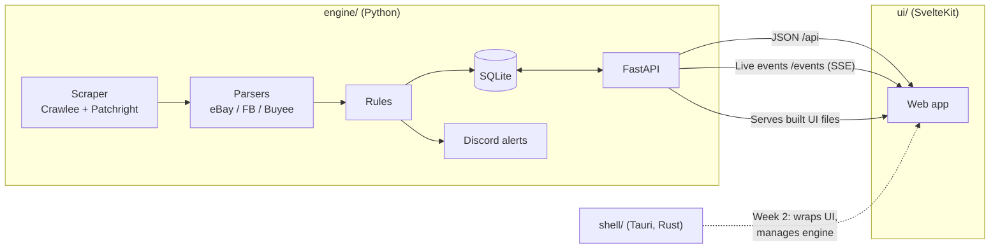

# Deal Watch

A self-hosted app that watches second-hand marketplaces (eBay, Facebook Marketplace, Buyee) for listings that match your rules, and alerts you on Discord when a deal turns up.

> **Status:** 🚧 Early development (Week 1 of the build plan). The UI shell is done: it builds to static files and has page navigation and a colour theme. The engine is being built. See [Roadmap](#roadmap).

## Table of Contents

- [About](#about)
- [Features](#features)
- [Architecture](#architecture)
- [Tech Stack](#tech-stack)
- [Getting Started](#getting-started)
- [Usage](#usage)
- [Project Structure](#project-structure)
- [Development Workflow](#development-workflow)
- [Security Notes](#security-notes)
- [Roadmap](#roadmap)
- [Troubleshooting](#troubleshooting)
- [Contributors](#contributors)
- [License](#license)

## About

Good deals on second-hand sites disappear fast, and checking several sites by hand is slow. Deal Watch runs your saved searches on a schedule, filters the results through your own rules, and pings you only when something worth looking at appears. Everything runs locally on your own machine.

## Features

Planned for the first release (Week 1):

- **Saved searches** across eBay, Facebook Marketplace and Buyee
- **Rules** that give every new listing a verdict (match / no match)
- **Discord alerts** for matches
- **Listings page** with list and grid views, keyword search, filters with counts, and status buttons (wishlist / skip / to review / remove)
- **Live status** of each site's checks, pushed to the UI as they happen
- **Installable app** (PWA) on desktop or phone home screen

Planned for Week 2:

- **Desktop app** (Tauri) with a tray icon that starts and stops the engine for you

## Architecture



- The **engine** (Python) does all the work: it runs searches, parses results, applies rules, stores listings in SQLite and sends alerts.
- **FastAPI** is the only server. It exposes the JSON API, streams live events with Server-Sent Events (SSE), and serves the built UI as static files.
- The **UI** is a single-page app built to plain HTML/CSS/JS with SvelteKit's static adapter. It runs entirely in the browser and gets all its data from the API.
- The **API contract** is defined in Python (Pydantic models). The UI's TypeScript types are generated from FastAPI's OpenAPI schema, so both sides stay in sync.

## Tech Stack

| Area | Technology | Why |
|---|---|---|
| Engine | Python, FastAPI, Pydantic | Fast to build; OpenAPI schema generated for free |
| Scraping | Crawlee, Patchright | Logged-in browser sessions, repeating crawl cycles |
| Database | SQLite (WAL mode), FTS5 trigram search | Zero setup, single file, fast full-text search |
| UI | SvelteKit 3, Svelte 5, TypeScript, Vite | Small, fast output; compiles to static files |
| Types | openapi-typescript | UI types generated from the API, never hand-written |
| Desktop | Tauri (Rust) | Small native wrapper around the UI |
| Alerts | Discord webhooks | No bot hosting needed |

## Getting Started

### Prerequisites

| Tool | Version | Check with |
|---|---|---|
| Git | any recent | `git --version` |
| Node.js | current LTS | `node -v` |
| npm | comes with Node | `npm -v` |
| Python | _TBD (engine)_ | `python --version` |

### Clone

```sh
git clone https://github.com/DanteIPR/DealsWatch.git
cd DealsWatch
```

### Run the UI (development)

```sh
cd ui
npm install
npm run dev
```

Open the `localhost` link printed in the terminal (usually http://localhost:5173). Edits to files in `ui/src` appear in the browser instantly on save.

### Run the engine

_Coming in E1–E4._

### Build the UI for production

```sh
cd ui
npm run build
```

This writes a static site to `ui/build/`:

- `200.html` is the **fallback page**. The UI is a single-page app (`ssr = false`), so every page is drawn in the browser from this one file.
- `_app/` holds the JavaScript and CSS. Filenames include a content hash (e.g. `app.DVC7OWxv.js`), so browsers can cache them forever.

To preview the built version locally (port 4173 instead of 5173):

```sh
npm run preview
```

> **For the engine (FastAPI):** serve `ui/build/` as static files, and return `200.html` for any URL that isn't an API route or a real file. Without this, refreshing the browser on a page like `/rules` gives a 404.

`build/` is generated output and is ignored by Git. Never commit it.

## Usage

_Coming once the full loop works (Day 6)._

## Project Structure

```
DealsWatch/
├── engine/          # Python engine + FastAPI (Dante)       — coming soon
├── ui/              # SvelteKit web app (Oscar)
│   ├── src/
│   │   ├── routes/
│   │   │   ├── +layout.svelte  # Nav bar + page frame, wraps every page
│   │   │   ├── +layout.ts      # ssr = false (whole app runs in the browser)
│   │   │   ├── +page.ts        # Redirects / to /listings
│   │   │   ├── listings/       # /listings
│   │   │   ├── searches/       # /searches
│   │   │   ├── rules/          # /rules
│   │   │   └── settings/       # /settings
│   │   ├── lib/        # Shared code, imported via #lib
│   │   ├── app.css     # Global styles + colour variables
│   │   └── app.html    # HTML template
│   ├── static/      # Files served as-is (icons, robots.txt)
│   ├── package.json # Dependencies + npm scripts
│   └── vite.config.ts # Vite + SvelteKit config (SvelteKit 3 has no svelte.config.js)
├── shell/           # Tauri desktop wrapper (Week 2)       — coming soon
└── README.md
```

## Development Workflow

### Planning

Work is split into tickets (S = shared, E = engine, U = UI, R = Rust) tracked as issues on the GitHub Projects board.

### Branches

- `main` always works. Don't commit to it directly.
- One branch per ticket, named after it, e.g. `u1-sveltekit-setup`, `e2-search-index`.
- Delete branches once they're merged.

### Pull requests

1. Push your branch and open a PR into `main`.
2. Link the issue in the description (`Closes #3`).
3. The other developer reviews it before merging.

### Commit messages

Imperative mood, around 50 characters, completing the sentence *"This commit will…"*:

```
Scaffold SvelteKit app in ui/
Add listings filter sidebar
Fix price sorting for Buyee listings
```

### Code style

- UI: Prettier + ESLint. Run `npm run format` and `npm run lint` in `ui/`.
- Engine: _TBD_

## Security Notes

- **Runs locally only.** The API is intended to listen on `localhost`. Don't expose it to the internet.
- **Secrets stay out of Git.** The Discord webhook URL and any marketplace login sessions/browser profiles must live in local config or `.env` files that are listed in `.gitignore`.
- **Site terms.** Automated access may be against some marketplaces' terms of service. Use reasonable check intervals and personal accounts at your own risk.

## Roadmap

| ID | Ticket | Owner | Status |
|---|---|---|---|
| S1 | Repo + GitHub Projects board | Both | ✅ Done |
| S2 | Branch + PR workflow | Both | ✅ Done |
| S3 | API contract + generated types | Dante / Oscar | ⬜ To do |
| E1 | Database schema | Dante | 🔄 In progress |
| E2 | Search index (FTS5) | Dante | ⬜ To do |
| E3 | Data layer + tests | Dante | ⬜ To do |
| E4 | Real API | Dante | ⬜ To do |
| E5 | Crawlee test | Dante | ⬜ To do |
| E6a | eBay parser | Dante | ⬜ To do |
| E6b | Facebook + Buyee parsers | Dante | ⬜ To do |
| E7 | Rules | Dante | ⬜ To do |
| E8 | Alerts + images | Dante | ⬜ To do |
| E9 | Live events (SSE) | Dante | ⬜ To do |
| E10 | Join everything up | Dante | ⬜ To do |
| E11 | Live run + fixes | Dante | ⬜ To do |
| U1 | SvelteKit setup | Oscar | 🔍 In review |
| U2 | API client | Oscar | ⬜ To do |
| U3 | Listings page | Oscar | ⬜ To do |
| U4 | Searches + Rules pages | Oscar | ⬜ To do |
| U5 | Settings + live status | Oscar | ⬜ To do |
| U6 | PWA | Oscar | ⬜ To do |
| U7 | Glass styling | Oscar | ⬜ To do |
| R1 | Tauri shell | Oscar | ⬜ To do |
| R2 | Packaging | Oscar | ⬜ To do |

## Troubleshooting

Problems hit while setting up and building this project (mostly Windows):

| Problem | Cause | Fix |
|---|---|---|
| `'git' is not recognized` | Git not installed, or terminal opened before install | Install Git for Windows, then fully restart VS Code/terminal |
| `'winget' is not recognized` | App Installer missing | Install **App Installer** from the Microsoft Store |
| `Install-Module ... is not recognized` | Running in cmd, not PowerShell | Use PowerShell (prompt starts with `PS`) |
| `npm.ps1 cannot be loaded because running scripts is disabled` | PowerShell execution policy is Restricted | `Set-ExecutionPolicy -Scope CurrentUser -ExecutionPolicy RemoteSigned` |
| `Repository not found` when cloning | Wrong URL (the owner is Dante**I**PR, capital i) | Copy the URL from the green **Code** button instead of typing it |
| `LF will be replaced by CRLF` warnings | Windows line-ending conversion | Repo-wide `.gitattributes` with `* text=auto eol=lf` |
| `nothing added to commit but untracked files present` | Files not staged | `git add <files>` before `git commit` |
| `npm error enoent Could not read package.json` | Running npm from the repo root | `cd ui` first. npm commands must run where `package.json` is |
| PowerShell shows `>>` and waits | An unclosed quote or bracket, e.g. `'message"` | Ctrl+C, then retype with matching quotes |
| `Cannot find module './$types'` | Generated route types not picked up by the editor | `npx svelte-kit sync`, then **Ctrl+Shift+P → Svelte: Restart Language Server** |
| `Failed to resolve import` | Wrong relative path (`./` = this folder, `../` = one folder up) | Check where the file actually lives relative to the importing file |
| Changes don't show up / reviewer sees old code | File edited but not saved | Turn on **File → Auto Save** in VS Code |

## Contributors

- **Dante** ([@DanteIPR](https://github.com/DanteIPR)): engine, API, database, scraping
- **Oscar** ([@oscarrym](https://github.com/oscarrym)): UI, desktop shell, packaging

## License

_Not chosen yet._ Without a license, the code is "all rights reserved" by default, which means nobody else may legally reuse it. Pick one (e.g. MIT) before sharing the project widely.
